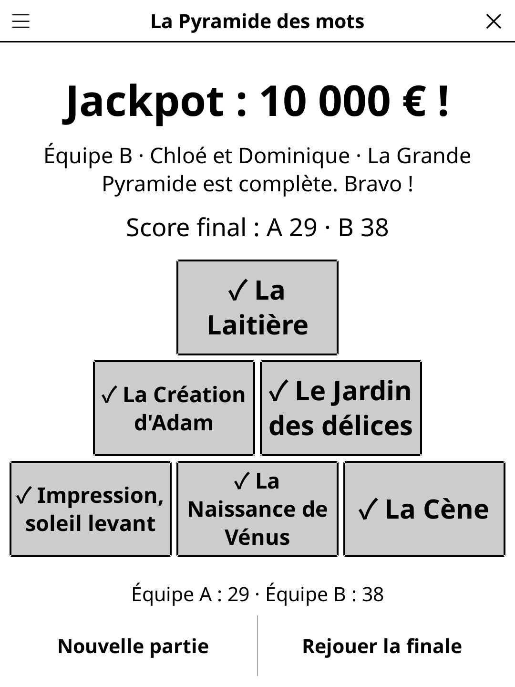

# wordpyramid.koplugin

**Word Pyramid** (FR *La Pyramide des mots*) — a word-guessing party game for
four players around one [KOReader](https://github.com/koreader/koreader)
device. Two teams of two: one player gives one-word clues, the partner
guesses, and every clue costs a **brick**. Inspired by the classic French TV
word game format of the 1990s–2000s (riddles, ping-pong, proper names, then a
final pyramid of expressions).

## Screenshot



## Rules

- **Teams A and B**, each a clue-giver and a guesser; the partners swap roles
  from turn to turn. The clue-giver holds the reader and sees the word; the
  guesser must not see the screen. Before every turn a neutral hand-over
  screen says who looks away; the word only appears after **Ready**.
- **Bricks** — every clue is ONE word and costs one brick. After each clue:
  **Found**, **Clue given / Wrong** (the brick is spent, next clue) or
  **Forbidden!** (the word is lost). **Undo** takes back the last tap.
- **Round 1 — Riddles**: 6 riddle titles are offered (*"He lost at
  Waterloo"*), teams pick A, B, A, B. A riddle hides 5 words linked to its
  answer (hat, Corsica, Josephine, emperor, Austerlitz → Napoleon): find them
  with a stock of **13 bricks**, 1 point each, then the guesser gives the
  answer, +1 if right. All 5 words found: +1 per unused brick; a missed word
  cancels the bonus.
- **Round 2 — Ping-pong**: 5 words played back and forth — one clue for team
  A, the next clue on the same word for team B, and so on. **13 bricks** for
  the round, **5 at most per word**; the team that finds it scores.
- **Round 3 — Against the clock**: 4 themes, 2 per team (the team behind
  picks first): **30 s** to get up to 7 words linked to the theme guessed,
  1 point each; Pass sends a word to the end.
- **Round 4 — Proper names**: 6 themes of 4 famous names; each team plays
  one theme (the team behind picks first). A name may take at most 4 bricks
  (setting: 3, 4 or 5). Before each name the other team may **bid a strictly
  lower brick count** and take it over. A name not found goes to the other
  team (1 point; 2 points if a 1-brick bid failed). The leading team plays
  the final; a tie is settled by a **sudden-death** name (clue-givers take
  turns, one clue each; a forbidden clue eliminates).
- **Final — The Great Pyramid**: **1 minute** to get **6 expressions**
  guessed (idioms, famous titles…), word by word or as a whole; the pyramid of
  6 boxes (3-2-1) fills as they are found. **All or nothing**: a forbidden
  clue or the end of the minute loses the prize (fake euros or points,
  setting). **Final again** replays it with a new pyramid.
- **Forbidden clues**: the word or part of it, compound or hyphenated words,
  translations, brand names, words of the same family or root (the same first
  sound is allowed), gestures, spelling. *Incitations* — a clue that sounds
  like the start of the word — are allowed only from the 3rd brick.

### Choices made in this adaptation

- **Round order**: against the clock is played between the ping-pong and the
  proper names, as in the 2002 seasons. The **Round 2** setting plays both
  (default), only the ping-pong, or only against the clock.
- The show's phone-in game for viewers has no table equivalent and is left
  out.
- In the riddles and the proper names the last clue's brick is spent even when
  it leads to the answer; a forbidden clue also spends its brick.

## Features

- Big words, brick counters drawn as bricks, only the timer refreshes each
  second (e-ink friendly).
- Player names typed once (one per line) and remembered.
- Content written natively in French and English; the content language is its
  own setting (**Language: FR/EN**, defaulting to KOReader's language), the
  interface follows KOReader. Content seen in recent games is avoided.

  | Content | EN | FR |
  |---|---|---|
  | Riddles (title + 5 words + answer) | 180 | 214 |
  | Proper-name themes × 4 names | 120 | 116 |
  | Against-the-clock themes × 8 words | 110 | 126 |
  | Great-Pyramid sets × 6 expressions | 200 | 172 |
  | Ping-pong words | 858 | 891 |

- One file per language and round under `content/`, loaded only when needed.
- Saved when the screen closes; a turn interrupted by closing the game resumes
  on its hand-over screen (never on a visible word). Untimed turns keep their
  progress; a timed turn (against the clock, the final) starts again.

## Installation

Copy `wordpyramid.koplugin/` into KOReader's `plugins/` folder, with the
shared `game-common/` library as its `common/` folder (the release zip
includes it). **Word Pyramid** then appears in the Tools menu.

## Development

`game.lua` is the game logic (no UI). `test_game_spec.lua` covers it and checks
the content files (counts, duplicates, riddle answers not among their own
words, length limits, excluded names and brands):

```
busted test_game_spec.lua
```

## License

GPL-3.0
